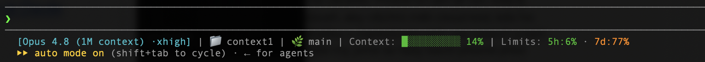

# Claude Code statusline

Jednoduchá, ale informačně hutná **status line pro [Claude Code](https://claude.com/claude-code)** — jeden bash skript, žádné závislosti navíc kromě `jq`. Ukazuje model, aktuální složku, git větev, zaplnění kontextu a čerpání limitů předplatného v jednom řádku.

> 🆕 Poslední verze **1.2.0** — čistší layout s labely `Context:`/`Limits:`, bez segmentů ceny a času. Historie verzí: **[CHANGELOG.md](CHANGELOG.md)**. Chceš vědět o nových verzích? Dej repu **Watch → Custom → Releases**.

```
[Opus 4.8 (1M context) ·xhigh] | 📁 youtubedb | 🌿 main± | Context: ████░░░░░░ 47% | Limits: 5h:38% ↻2h13m · 7d:72% ↻3d4h
```

> Náhled v reálu:
>
> 

## Co to ukazuje

| Část | Význam |
|---|---|
| `[Opus 4.8 (1M context) ·xhigh]` | model + reasoning effort (`·xhigh` se skryje, když ho prostředí nehlásí — třeba při API klíči) |
| `📁 youtubedb` | aktuální složka |
| `🌿 main±` | git větev; `±` značí necommitnuté změny (dirty working tree) |
| `Context: ████░░░░░░ 47%` | **zaplnění kontextového okna** — desetidílný bar, který mění barvu podle naplnění |
| `Limits: 5h:38% ↻2h13m · 7d:72% ↻3d4h` | **čerpání limitů předplatného** — pětihodinové okno a týdenní strop (`rate_limits` z payloadu); `↻` je odpočet do resetu okna (`resets_at`), aby bylo vidět nejen kolik zbývá, ale i kdy se to obnoví |

Barvy zaplnění kontextu i limitů:

- 🟢 zelená < 50 %
- 🟡 žlutá ≥ 50 %
- 🟠 oranžová ≥ 70 %
- 🔴 červená ≥ 90 %

Segment limitů se zobrazuje jen na předplatném Pro/Max a naskočí až po první odpovědi v session. Na Console API klíči pole `rate_limits` nechodí, takže se segment celý schová (nic nerozbije). Odpočet `↻` se zobrazí jen když payload obsahuje `resets_at`; formát je `3d4h` / `2h13m` / `45m`.

## Požadavky

- **bash** — na Windows přes **Git Bash** (viz [Instalace → Windows](#windows))
- **[`jq`](https://jqlang.github.io/jq/)** — parsování JSON, který Claude Code posílá na stdin (`brew install jq`)
- **git** — volitelně; bez gitu nebo mimo repozitář se zobrazí `no-git`

> Skript je defenzivní: když `jq` chybí nebo přijde nevalidní vstup, nespadne — jen zobrazí prázdné/nulové hodnoty. Počítá jen s celými čísly a čte git přes plumbing/porcelain, takže **nezávisí na jazyku systému** (funguje i na neanglické locale).

## Instalace

1. Stáhni `statusline.sh` (klidně do `~/.claude/statusline.sh`) a nastav mu práva ke spuštění:

   ```bash
   curl -o ~/.claude/statusline.sh https://raw.githubusercontent.com/faborsky/claude-code-statusline/main/statusline.sh
   chmod +x ~/.claude/statusline.sh
   ```

2. Zapni ho v Claude Code přes `~/.claude/settings.json` (globálně) nebo `.claude/settings.json` (per projekt):

   ```json
   {
     "statusLine": {
       "type": "command",
       "command": "~/.claude/statusline.sh"
     }
   }
   ```

   > `~` (i `$HOME`) se expanduje správně na macOS, Linuxu **i Windows**.

3. Otevři novou session — status line se objeví dole.

### Windows

statusLine command se na Windows spouští v **Git Bash** (a jako fallback PowerShell). Bash skript funguje beze změny, když máš nainstalovaný [Git for Windows](https://git-scm.com/download/win) (Git Bash) — což při práci s gitem skoro jistě máš:

- V cestách používej **lomítka dopředu** (`~/.claude/statusline.sh` nebo `C:/Users/<ty>/.claude/statusline.sh`), ne zpětná.
- ANSI barvy i emoji fungují (Git Bash / Windows Terminal).

Bez Git Bashe (čistě PowerShell) by skript potřeboval PowerShell port — ten tu zatím není.

## Přizpůsobení

Celé je to jeden krátký skript, takže úpravy jsou triviální:

- **Prahy barev kontextu a limitů** — hodnoty `50 / 70 / 90` ve funkci `pct_color`.
- **Layout / pořadí polí** — finální `printf` na konci souboru.
- **Délka baru** — desetidílný bar v sekci *„10-segment progress bar"*.
- **Labely a emoji** — text `Context:` / `Limits:` a `📁 🌿` v `printf` (standardní emoji, nepotřebuješ Nerd Font).

## Jak se počítá kontext

Skript bere primárně `context_window.used_percentage` z payloadu Claude Code (přesné — započítá i cache). Když pole chybí, spadne na ruční výpočet `total_input_tokens / context_window_size`. Celý JSON se parsuje **jedním** průchodem `jq`.

## Atribuce / Credit

Vychází ze statusline ukázané v tutoriálu **Leonarda Grigoria** — *„My actual Claude Code workflow"* ([YouTube](https://www.youtube.com/watch?v=Hhiwq1aHK7o), kanál [Build & Ship with AI](https://www.youtube.com/@leonardogrig)).

Tahle verze je **podstatně upravená**: jeden `jq` průchod místo pěti, primárně přesné `used_percentage` s fallbackem, vlastní prahy barev a desetidílný bar, labely Context:/Limits: a ošetření chyb. Díky Leonardovi za původní nápad. 🙏

## Licence

[MIT](LICENSE) © 2026 Jindřich Fáborský — vztahuje se na úpravy v tomto repozitáři.
